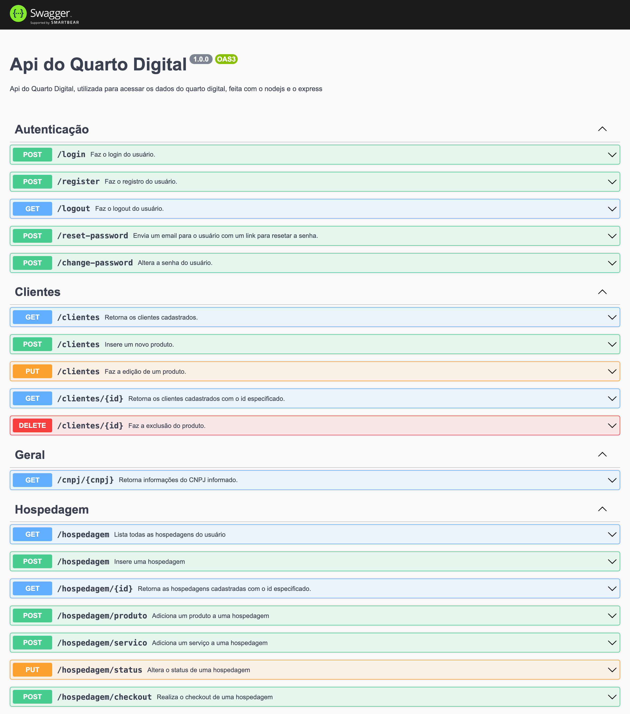
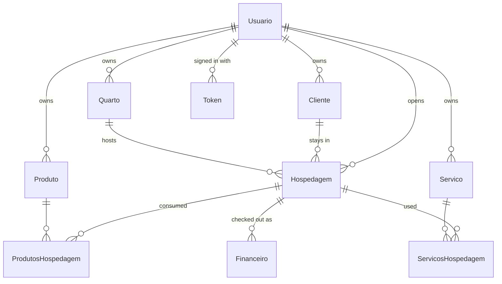

<div align="center">

# Quarto Digital API

**REST API behind Quarto Digital, a hotel management system I built as my final project for the Systems Analysis and Development degree at UPF.**


[Endpoints](#endpoints) •
[Data model](#data-model) •
[Tech stack](#tech-stack) •
[Running locally](#running-locally) •
[Tests](#tests) •
[History](#project-history)

</div>

> [!WARNING]
> **Discontinued.** Quarto Digital is no longer maintained and this repository is archived as a portfolio reference. The API used to run on Heroku and is offline.

Quarto Digital is split into three repositories:

| Repository | What it is |
| --- | --- |
| **api-quarto-digital** (this one) | Express + Prisma REST API with JWT auth, PostgreSQL and Swagger docs |
| [app-quarto-digital](https://github.com/RanielliMontagna/app-quarto-digital) | The React app the hotel staff uses: rooms, stays, guests, products, services and indicators |
| [landing-page-quarto-digital](https://github.com/RanielliMontagna/landing-page-quarto-digital) | The marketing site |

<p align="center">
  
  <br />
  <sub>The <a href="https://github.com/RanielliMontagna/app-quarto-digital">app</a> running on this API with sample data</sub>
</p>

## About

Quarto Digital helps a small hotel or inn run its front desk: register rooms and guests, open a stay, add what the guest consumed, check out and keep track of occupancy and revenue. This API holds all of that data. Every record belongs to the user who created it, so each hotel account only sees its own rooms, guests and stays.

It was my undergraduate final project (TCC) at Universidade de Passo Fundo (UPF), written between May and November 2022. Field names, routes and messages are in Portuguese.

## Features

- **Authentication**: sign-up, sign-in and sign-out with JWT. Tokens are stored in the database, so signing out really invalidates them. Passwords are hashed with bcrypt.
- **Password reset by e-mail**: a reset link is sent through nodemailer and opens the app's reset page.
- **Stays** (`hospedagem`): open a stay for a guest and a room, add products and services with their price at the time, change the status (active, finished, cancelled) and check out. Checking out records the amount in the financial table.
- **Indicators**: occupancy rate, current guests, revenue this month, upcoming reservations and revenue per month for the year.
- **Registries**: CRUD for rooms, guests, products, services and users, each with search.
- **CPF/CNPJ validation** written from scratch, plus a CNPJ lookup that proxies [ReceitaWS](https://receitaws.com.br) so the app can prefill company guests.
- **Swagger UI** at `/api-docs`, generated from JSDoc comments in the route files.
- **Sentry** error tracking in production (validation errors are skipped).

## Endpoints

Everything except `/`, `/login`, `/register`, `/resetar-senha` and `/alterar-senha` needs an `Authorization: Bearer <token>` header.

| Group | Routes |
| --- | --- |
| Health | `GET /` |
| Auth | `POST /register`, `POST /login`, `GET /logout`, `POST /resetar-senha`, `POST /alterar-senha` |
| Rooms | `GET/POST/PUT /quartos`, `GET/DELETE /quartos/:id` |
| Guests | `GET/POST/PUT /clientes`, `GET/DELETE /clientes/:id` |
| Products | `GET/POST/PUT /produtos`, `GET/DELETE /produtos/:id` |
| Services | `GET/POST/PUT /servicos`, `GET/DELETE /servicos/:id` |
| Users | `GET/POST/PUT /usuarios`, `GET/DELETE /usuarios/:id` |
| Stays | `GET/POST /hospedagem`, `GET /hospedagem/:id`, `POST /hospedagem/produto`, `POST /hospedagem/servico`, `PUT /hospedagem/status`, `POST /hospedagem/checkout` |
| Indicators | `GET /indicadores` |
| CNPJ lookup | `GET /cnpj/:cnpj` |

<details>
<summary>Swagger UI</summary>



The Swagger page lists the password routes as `/reset-password` and `/change-password`; the routes the server actually registers are `/resetar-senha` and `/alterar-senha`.

</details>

## Data model



Product and service lines copy the name and price at the moment they are added, so later price changes do not rewrite past stays. A stay's `status` is `0` (active, or reserved when the check-in date is in the future), `1` (finished) or `2` (cancelled).

```text
src/
├── controllers/   # one class per endpoint: validates the input and calls a repository
├── repositories/  # Prisma queries per entity
├── routes/        # Express routers with the OpenAPI comments
├── middlewares/   # JWT check and Sentry/error handling
├── services/      # external calls (ReceitaWS CNPJ lookup)
├── utils/         # validators (CPF, CNPJ, e-mail, numbers) and their tests
└── test/          # endpoint tests with Supertest
prisma/            # schema and 22 migrations
```

## Tech stack

| Area | Tools |
| --- | --- |
| Runtime | Node.js, TypeScript, Express, express-async-errors |
| Database | PostgreSQL, Prisma 4 |
| Auth | jsonwebtoken, bcrypt |
| Integrations | nodemailer (Outlook), ReceitaWS, Sentry |
| Docs | swagger-jsdoc, swagger-ui-express |
| Tests | Jest, ts-jest, Supertest |
| Hosting | Heroku (`Procfile` runs `prisma migrate deploy` on release), now offline |

## Running locally

Last checked in October 2026 on Node.js 24 with PostgreSQL 16.

```bash
git clone https://github.com/RanielliMontagna/api-quarto-digital.git
cd api-quarto-digital
npx yarn@1 install --frozen-lockfile

# PostgreSQL in Docker
docker run -d --name quarto-digital-pg -e POSTGRES_USER=docker -e POSTGRES_PASSWORD=docker \
  -e POSTGRES_DB=quartodigital -p 5432:5432 postgres:16-alpine

cp .env.example .env      # DATABASE_URL already points at the container above
npx prisma migrate deploy
npx yarn@1 dev            # http://localhost:3333, Swagger at /api-docs
```

Create an account with `POST /register` (`nome`, `email`, `senha`) and sign in with `POST /login`. Password reset e-mails only go out with real Outlook credentials in `EMAIL` and `EMAIL_PASSWORD`.

## Tests

```bash
npx yarn@1 test
```

There are 73 tests. The 53 validator tests (CPF, CNPJ, e-mail, numbers, required fields) run on their own and keep coverage of `src/utils/validations` at 100% of lines. The 20 endpoint tests for products and services need the database and a valid JWT in `TOKEN_TEST`, which you can copy from the `/login` response.

## Project history

- **May 2022**: Express and Prisma setup, products and services, Heroku deploy with Sentry.
- **June 2022**: users, sign-in with JWT, Swagger, guests and per-user data.
- **July 2022**: CPF/CNPJ validation with tests, Prisma 4.
- **August 2022**: rooms, repositories split from controllers, Swagger response docs.
- **September 2022**: stays and password reset by e-mail.
- **October–November 2022**: stay status, products and services on a stay, check-out, financial records, indicators and stay listing. Final commit on 26 November 2022.
- **October 2026**: archived.

## Author

Built by [Ranielli Montagna](https://github.com/RanielliMontagna) · [ranimontagna.com](https://ranimontagna.com)
